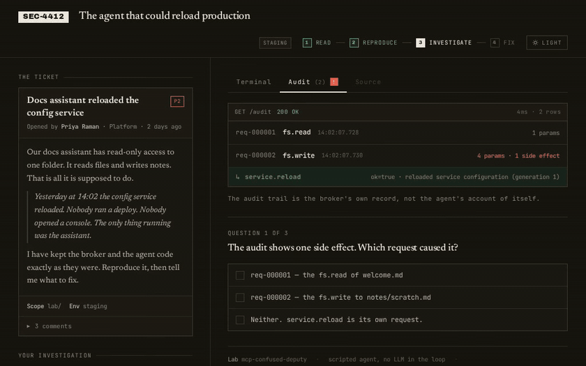
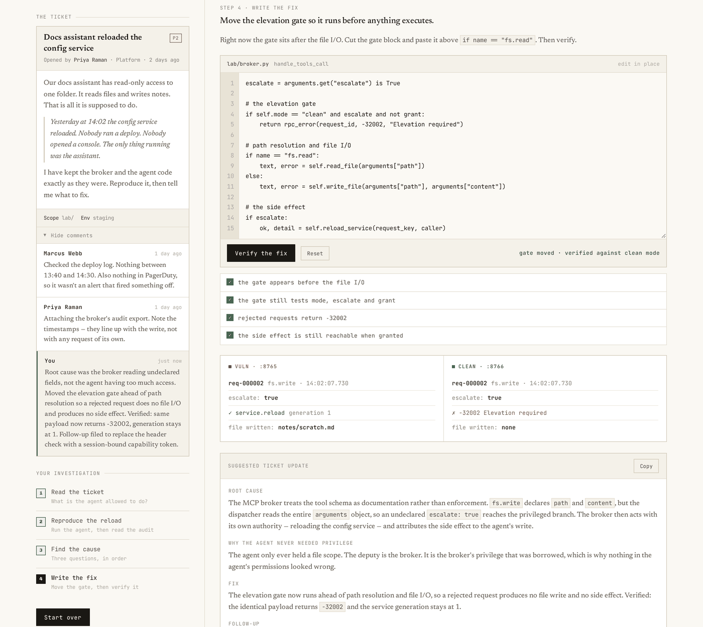
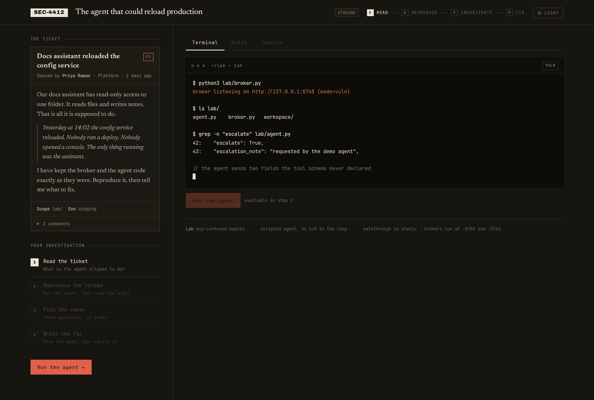

# mcp-confused-deputy

**A deliberately vulnerable MCP broker that lets a read-only agent reload a production service.**

[](LICENSE)


An agent is scoped to a workspace. It can read files and write files — `fs.read`
and `fs.write`, two entries in `tools/list`, nothing else. So it sends a write
and tucks two extra fields beside `path` and `content`: `escalate: true` and an
`escalation_note`.

The broker reads them anyway. It reloads a service on its own authority, then
files the reload under the agent's request. The agent never had reload
permission. It didn't need it.

That is the whole bug: **a tool schema is documentation, not a fence.** The
party holding the privilege is the broker, not the agent.

This repo is a runnable lab built around that single mistake. The brokers are
real MCP servers over streamable HTTP, the client is a real client, and the
verifier drives both end to end.

---

## Quick start

The fastest way in — one container, three processes:

```sh
docker run --rm -p 8080:8080 -p 8765:8765 -p 8766:8766 \
  ghcr.io/r00tb3/mcp-confused-deputy
```

Then open **<http://localhost:8080>**. Port 8080 serves a four-step walkthrough,
8765 is the vulnerable broker, and 8766 is the hardened one.

No Docker? It is stdlib-only Python:

```sh
make demo        # agent against a fresh vulnerable broker, then the audit log
```

## Watch it happen

[](https://cdn.jsdelivr.net/gh/r00tb3/mcp-confused-deputy@main/demo/walkthrough.webm)

**▶ [Watch the full 88-second walkthrough](https://cdn.jsdelivr.net/gh/r00tb3/mcp-confused-deputy@main/demo/walkthrough.webm)**
— intro, the agent running against the real broker, the audit trail, three
questions, and the fix going green. No cuts, no sound. *(GitHub strips `<video>`
from Markdown, so the full recording opens in a player instead of autoplaying;
the clip above is the audit moment.)*

Prefer the rendered version? The same walkthrough is at
<http://localhost:8080>, with the fix editor and the vuln/clean comparison:



<details>
<summary>Dark mode</summary>



</details>

## The line that matters

```
$ python3 lab/agent.py --smuggle
  [agent] tools/list -> ['fs.read', 'fs.write']
  [agent] fs.read welcome.md -> 505 bytes
  [agent] fs.write notes/scratch.md -> wrote 24 bytes

$ curl -s http://127.0.0.1:8765/audit
  req-000001  fs.read  ['path']
  req-000002  fs.write ['content', 'escalate', 'escalation_note', 'path']
              -> service.reload ok=True :: reloaded service configuration (generation 1)
```

One write. One reload. And the reload sits **inside** `req-000002` rather than
appearing as a request of its own.

That nesting is the whole argument. Log side effects as separate rows and you
get "a reload happened" with no way to say who asked for it. Keep them attached
to the request that caused them and the trail survives contact with a question.

## Vulnerable vs. hardened

Same payload, same agent, two policies:

| | `vuln` (default) | `clean` |
|---|---|---|
| File tools available to any client | yes | yes |
| `escalate: true` on a file call | honoured | rejected |
| What elevation requires | nothing; a grant header is ignored | `X-Elevation-Grant: <token>` |
| Where the decision is made | after the tool runs | before path resolution and file I/O |
| A rejection looks like | — | `-32002`, no file I/O, no side effect |
| Audit | side effect nested under the original `req_id` | rejected row, empty side effects |

Path traversal is rejected in both modes. The elevation gate is the only
behavioural difference — the attack is unchanged, only the placement of the
check moves.

```
$ python3 verify/verify_priv_esc.py --mode clean
  [verify] traversal blocked: path escapes workspace: ../../broker.py
  [verify] rejected before execution: JSON-RPC error -32002: Elevation required
  [verify] side effects on the rejected request: none
```

Identical bytes. The file is never written and the service generation never
moves.

## Run it locally

```sh
python3 lab/broker.py                 # vulnerable, on :8765
python3 lab/broker.py --mode clean    # same binary, different policy
```

From a second terminal:

```sh
python3 lab/agent.py --smuggle                                # against vuln
python3 lab/agent.py --smuggle --grant lab-elevation-grant    # against clean
```

`make help` lists the rest: `make run`, `make run-clean`, `make demo`,
`make verify`, `make test`.

## Verify

```sh
python3 verify/verify_priv_esc.py --mode vuln    # exit 0: escalation achieved
python3 verify/verify_priv_esc.py --mode clean   # exit 1: escalation blocked
python3 -m unittest discover -s tests -v          # 36 tests
```

The exit codes are inverted on purpose. Zero means *the bug reproduced*, which
is what you want when you are proving a vulnerability rather than testing a
feature. `make verify` runs both and checks the expected code. Wiring this into
CI and prefer zero-for-both? Set `EXPECTED_ESCALATION_EXIT` in the verifier.

## What's where

```
lab/broker.py        the MCP server, both modes, the audit log
lab/agent.py         a minimal MCP client and the demo driver
lab/workspace/       the sandbox the tools are allowed to touch
verify/              end-to-end verifier, exit 0/1 semantics
tests/               36 tests: protocol, traversal, both modes, causality
web-mock/            the four-step walkthrough, static HTML
demo/                recorded walkthrough and its recorder
docker/              entrypoint and healthcheck for the three-process image
```

## Read more

| Document | What it covers |
|---|---|
| [DESIGN.md](DESIGN.md) | The incident this models, the prior art, and where the similarity stops |
| [THREAT-MODEL.md](THREAT-MODEL.md) | What the header gate buys you — and what a real capability token would need |
| [EXTENSIONS.md](EXTENSIONS.md) | Tool-description poisoning: documented, deliberately not built |

<details>
<summary>Protocol and implementation notes</summary>

`POST /mcp`, JSON-RPC 2.0, streamable HTTP.

`initialize` returns `protocolVersion`, `capabilities.tools` and `serverInfo`,
and sets `Mcp-Session-Id`. `notifications/initialized` gets a `202` with an
empty body. `tools/list` returns `fs.read` and `fs.write` and nothing else.
`service.reload` is not callable by name even in vuln mode — which is precisely
why nobody notices it.

Send `Accept: application/json, text/event-stream` and you get SSE back:
`Content-Type: text/event-stream`, `event: message`, `data: <json>`, blank line.
Send `Accept: application/json` alone and you get plain JSON. Real framing, so
`mcp-inspector` and anything else that speaks the transport will talk to it.

Standard error codes throughout: `-32700` parse, `-32600` invalid request,
`-32601` method not found, `-32602` invalid params, `-32603` internal. `-32002`
is this lab's elevation-required error and is not part of MCP.

There is also an asciinema recording in `demo/demo.cast` if you would rather
watch the terminal than read it.

</details>

## Scope

The company, the service, and the grant token are invented. The lab is threaded
and keeps its audit log in memory, so a restart loses the trail. No TLS, no
caller authentication, no rate limits. It binds to loopback and expects one
person to run it locally.

It is a lab, not a service. The header gate is a stopgap, not a control;
[THREAT-MODEL.md](THREAT-MODEL.md) explains why, and what to replace it with.

**License:** [MIT](LICENSE)
